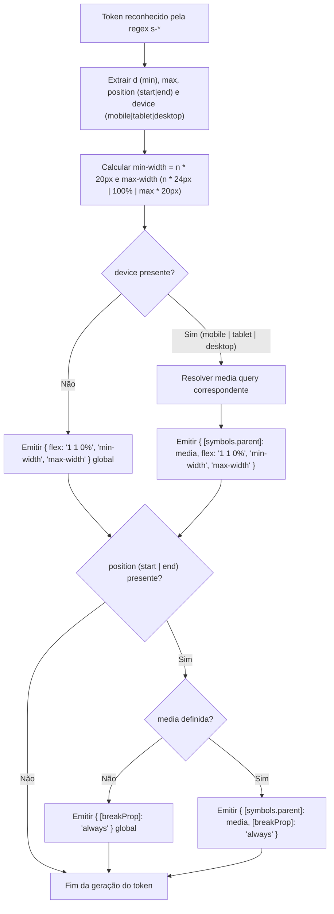

# Especificação Técnica — Escopo Responsivo por Dispositivo nas Regras de Dimensionamento `s-*` (`presetMaxUno`)

- **Projeto:** `@maxvue/max-components-ui`
- **Worktree:** `wt-13a68947`
- **Data:** 2026-10-14

---

## 1. Contexto & Objetivo

### Problema a Resolver
Ao utilizar múltiplos tokens utilitários `s-*` em um mesmo item interno do `MaxGrid` combinando um dimensionamento padrão com um dimensionamento específico por dispositivo — como no caso real em `CommercialProposalDetailPage.vue`:

```html
<MaxInputCpfCnpj s11-11 s20-full-mobile v-model="proposalStore.data.client_document" label="CPF ou CNPJ" />
```

o componente permanece com o dimensionamento `s20-full` (`flex: 1 1 0%; min-width: 400px; max-width: 100%`) tanto no mobile quanto no desktop, ignorando `s11-11` (`min-width: 220px; max-width: 220px`) em telas desktop.

A causa raiz está na regra dinâmica `s-*` em `src/presetMaxUno.ts` (linhas 84–117):
1. O gerador da regra emite incondicionalmente as propriedades de dimensionamento (`flex: '1 1 0%'`, `min-width: '${n * 20}px'`, `max-width: maxWidth`) no escopo global (sem `symbols.parent`), independentemente de o token possuir sufixo de dispositivo (`-mobile`, `-tablet`, `-desktop`).
2. A restrição de `@media` (`mobile`: `@media (max-width: 767.98px)`, `tablet`: `@media (max-width: 1000.98px)`, `desktop`: `@media (min-width: 1001px)`) estava sendo aplicada apenas ao segundo `yield` condicional de `position` (`start` / `end` → `break-before` / `break-after`).
3. Como resultado, `s20-full-mobile` gera `[s20-full-mobile=""]{flex:1 1 0%;min-width:400px;max-width:100%;}` fora de qualquer `@media`. Por possuir a mesma especificidade CSS `(0, 1, 0)` que `[s11-11=""]` e ser declarado após `s11-11`, `s20-full-mobile` sobrescreve `s11-11` em qualquer resolução de tela.

### Valor Entregue
- Garantir que qualquer token `s-*` qualificado com sufixo de dispositivo (`-mobile`, `-tablet`, `-desktop`) encapsule suas propriedades de dimensionamento (`flex`, `min-width`, `max-width`) — bem como eventual propriedade de posição (`break-before` / `break-after`) — dentro da `@media` query correspondente ao dispositivo.
- Permitir a composição declarativa de tamanhos base e tamanhos responsivos no mesmo elemento ou componente filho de `MaxGrid` (ex.: `s11-11 s20-full-mobile`), mantendo `s11-11` ativo no desktop e aplicando `s20-full-mobile` exclusivamente em viewports mobile (`<= 767.98px`).

---

## 2. Escopo

### Dentro do Escopo (In Scope)
1. **`src/presetMaxUno.ts`**:
   - Atualizar a regra dinâmica `s-*` para resolver a `@media` query a partir do modificador `device` (`mobile` → `@media (max-width: 767.98px)`, `tablet` → `@media (max-width: 1000.98px)`, `desktop` → `@media (min-width: 1001px)`) e associar `[symbols.parent]: media` tanto ao objeto de dimensionamento (`flex`, `min-width`, `max-width`) quanto ao objeto de quebra (`break-before` / `break-after`, quando `position` estiver presente).
   - Preservar inalterado o comportamento de tokens sem modificador de dispositivo (ex.: `s11-11`, `s10-full`, `s7-end`, `s3-10-start`).
2. **Testes Automatizados Unitários, de Geração CSS e de Navegador**:
   - Atualizar e expandir `tests/preset/presetMaxUno.test.ts` para validar que tokens `s-*` com `mobile`, `tablet` ou `desktop` (com ou sem `start`/`end`) incluem `[symbols.parent]` com a `@media` query correspondente no objeto de dimensões (e no de quebra, quando houver posição).
   - Atualizar e expandir `tests/preset/presetMaxUno.generate.test.ts` para validar o CSS real gerado pelo UnoCSS (incluindo `presetAttributify`) em tokens isolados com dispositivo e na combinação `<MaxInputCpfCnpj s11-11 s20-full-mobile />`, garantindo a ordem na folha de estilos (regra base global antes da regra `@media`).
   - Expandir `tests/browser/maxGridLineBreaks.browser.ts` para validar no navegador real (Playwright) o estilo computado (`getComputedStyle`) de um item interno do `MaxGrid` com `s11-11 s20-full-mobile` em viewport desktop (`1280x800`, onde `max-width` computado deve ser `220px`) e em viewport mobile (`375x667`, onde `min-width` é `400px` e `max-width` é `100%`).
3. **Documentação e Playground**:
   - Atualizar `docs/THEME.md`, `COMPONENTS.md` e `playground/src/scenarios/layout-grid.vue` para refletir o comportamento responsivo real dos tokens `s-*` com sufixo de dispositivo (`-mobile`, `-tablet`, `-desktop`).

### Fora do Escopo (Out of Scope)
- Alteração da lógica de particionamento estrutural de VNodes em `.max-grid-row` dentro de `src/components/MaxGrid.vue` e `src/components/base/gridSlotRows.ts` (que permanece restrita aos tokens estruturais sem sufixo de dispositivo `^s-?\d+(?:-(?:full|max|\d+))?-(start|end)$`).
- Alterações em componentes de input (`MaxInputCpfCnpj.vue`, `InputBase.vue`), cujo repasse de atributos para o elemento raiz já opera conforme esperado.
- Alterações no repositório consumidor `engeapp`.

---

## 3. Arquitetura & Mudanças Técnicas

### 3.1. Fluxo de Resolução de Tokens `s-*` em `src/presetMaxUno.ts`



### 3.2. Contrato de Saída da Regra `s-*`

| Padrão de Token | Exemplo | Dimensões (`flex`, `min-width`, `max-width`) | Quebra (`break-before` / `break-after`) |
| :--- | :--- | :--- | :--- |
| Sem posição e sem dispositivo | `s11-11`, `s-11-full` | Escopo global (sem `@media`) | Não emitida |
| Com posição e sem dispositivo | `s12-12-end`, `s3-10-start` | Escopo global (sem `@media`) | Escopo global (sem `@media`) |
| Sem posição e com dispositivo | `s20-full-mobile`, `s10-tablet`, `s15-desktop` | Dentro de `@media` do dispositivo (`[symbols.parent]`) | Não emitida |
| Com posição e com dispositivo | `s3-10-start-mobile`, `s5-max-desktop-end` | Dentro de `@media` do dispositivo (`[symbols.parent]`) | Dentro de `@media` do dispositivo (`[symbols.parent]`) |

### 3.3. Mapeamento de Breakpoints (`device` → `@media`)
- `mobile`: `@media (max-width: 767.98px)`
- `tablet`: `@media (max-width: 1000.98px)`
- `desktop`: `@media (min-width: 1001px)`

### 3.4. Ordenação na Cascata CSS do UnoCSS
O UnoCSS agrupa as regras por `parent` na folha de estilos e ordena as chaves de `parent`:
1. Regras sem `parent` (`""`, ex.: `[s11-11=""]`) são emitidas primeiro.
2. Regras com `@media` (`parent !== ""`, ex.: `@media (max-width: 767.98px){[s20-full-mobile=""]{...}}`) são emitidas depois.
3. Entre `@media (max-width: 1000.98px)` (`tablet`) e `@media (max-width: 767.98px)` (`mobile`), a ordenação lexicográfica coloca `1000.98px` antes de `767.98px`, garantindo que `mobile` sobrescreva `tablet` e a regra base quando a tela for `<= 767.98px`.

### 3.5. Arquivos Afetados
- `src/presetMaxUno.ts` (modificação da regra `s-*`)
- `tests/preset/presetMaxUno.test.ts` (atualização e adição de casos de teste unitários do matcher/generator)
- `tests/preset/presetMaxUno.generate.test.ts` (atualização e adição de casos de geração CSS real do UnoCSS, incluindo combinação `s11-11 s20-full-mobile` com attributify)
- `tests/browser/maxGridLineBreaks.browser.ts` (adição de teste de viewport desktop vs mobile para `s11-11 s20-full-mobile` dentro do `MaxGrid`)
- `docs/THEME.md` (atualização da seção 7.2 sobre tokens `s-*` com dispositivo)
- `COMPONENTS.md` (atualização da documentação de `MaxGrid` e tokens responsivos `s-*`)
- `playground/src/scenarios/layout-grid.vue` (atualização da nota descritiva e exemplo de combinação responsiva `s11-11 s20-full-mobile`)

---

## 4. Plano de Execução Faseado

1. **Etapa 1 — Correção da Regra `s-*` no `presetMaxUno` (`src/presetMaxUno.ts`)**:
   - Extrair o mapeamento `device` → `media` antes do `yield` das dimensões.
   - Aplicar `[symbols.parent]: media` ao objeto de dimensões quando `media` estiver presente, mantendo a aplicação de `[symbols.parent]: media` também no objeto de quebra (`position`).
2. **Etapa 2 — Atualização dos Testes Unitários e de Geração UnoCSS (`tests/preset/presetMaxUno.test.ts` e `tests/preset/presetMaxUno.generate.test.ts`)**:
   - Atualizar as asserções dos tokens com `-mobile`, `-tablet` e `-desktop` para refletir o escopo `@media` nas dimensões.
   - Adicionar teste específico para a combinação attributify `<MaxInputCpfCnpj s11-11 s20-full-mobile />` validando que `[s11-11=""]` permanece fora de `@media` e `[s20-full-mobile=""]` é gerado dentro de `@media (max-width: 767.98px)` após a regra base.
3. **Etapa 3 — Teste de Integração em Navegador Real (`tests/browser/maxGridLineBreaks.browser.ts`)**:
   - Adicionar caso de teste renderizando `<MaxGrid><MaxInputCpfCnpj s11-11 s20-full-mobile v-model="doc" label="CPF ou CNPJ" /></MaxGrid>` e verificando `getComputedStyle` com `page.viewport(1280, 800)` (`minWidth: '220px'`, `maxWidth: '220px'`) e `page.viewport(375, 667)` (`minWidth: '400px'`, `maxWidth: '100%'` ou largura limitada ao contêiner).
4. **Etapa 4 — Atualização de Documentação e Playground (`docs/THEME.md`, `COMPONENTS.md`, `playground/src/scenarios/layout-grid.vue`)**:
   - Atualizar a descrição do comportamento dos sufixos `-mobile`, `-tablet` e `-desktop` e incluir exemplo de sobrescrita responsiva `s11-11 s20-full-mobile`.
5. **Etapa 5 — Validação em Lote**:
   - Executar os testes unitários, teste de navegador, checagem de tipos e lint em lote após concluir todas as edições.

---

## 5. Critérios de Aceite & Validação

- **CA-01:** Tokens `s-*` sem sufixo de dispositivo (`s11-11`, `s-11-full`, `s12-12-end`, `s3-10-start`) continuam gerando dimensões e quebras no escopo global.
- **CA-02:** Tokens `s-*` com sufixo de dispositivo e sem posição (`s20-full-mobile`, `s-50-mobile`, `s50-tablet`, `s-50-desktop`) geram `flex: 1 1 0%`, `min-width` e `max-width` exclusivamente dentro da respectiva `@media` query (`767.98px`, `1000.98px`, `1001px`).
- **CA-03:** Tokens `s-*` com sufixo de dispositivo e com posição (`s-50-start-mobile`, `s50-mobile-end`, `s3-10-start-desktop`, etc.) geram tanto as dimensões quanto a propriedade `break-before`/`break-after` dentro da respectiva `@media` query.
- **CA-04:** Em `<MaxInputCpfCnpj s11-11 s20-full-mobile />` dentro de `<MaxGrid>`, o componente apresenta `min-width: 220px` e `max-width: 220px` no desktop (`1280px`) e aplica `min-width: 400px` e `max-width: 100%` no mobile (`375px`).
- **Comandos de Validação:**
  - `npx vitest run tests/preset/presetMaxUno.test.ts tests/preset/presetMaxUno.generate.test.ts tests/components/MaxGrid.test.ts`
  - `npx vitest run --config vitest.browser.config.ts tests/browser/maxGridLineBreaks.browser.ts`
  - `npm run type-check`
  - `npm run type-check:test`
  - `npm run lint`
