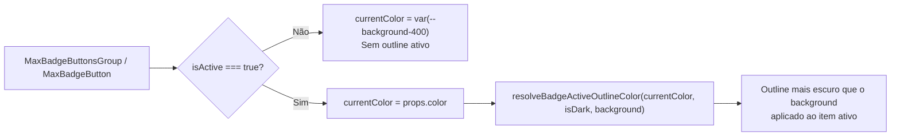

# Especificação Técnica (Spec) — Outline Mais Escuro para Item Ativo em MaxBadgeButton e MaxBadgeButtonsGroup

- **Projeto:** `@maxvue/max-components-ui`
- **Worktree:** `wt-284d96a7`
- **Data:** 2026-10-14

---

## 1. Contexto & Objetivo

### Problema a Resolver
Atualmente, o componente `MaxBadgeButton` (também referenciado como `MaxBadgeButtons`) e o agrupador `MaxBadgeButtonsGroup` diferenciam o estado ativo do estado inativo apenas alterando a cor repassada ao `MaxBadge` interno (`props.color` quando ativo e `var(--background-400)` quando inativo). Quando um item está ativo, ele não apresenta um contorno (`outline`) mais escuro que a cor de fundo (`background`) do próprio badge para reforçar visualmente o estado selecionado/ativo.

### Valor Entregue
Adicionar ao item ativo em `MaxBadgeButton` / `MaxBadgeButtons` e `MaxBadgeButtonsGroup` um `outline` cuja cor seja calculada dinamicamente para ser estritamente mais escura (menor luminância relativa WCAG) que o `background` efetivo do item, preservando matiz e saturação da cor do badge tanto em modo claro quanto em modo escuro e suportando sobrescrita via prop `background`.

---

## 2. Escopo

### Dentro do Escopo (In Scope)
1. **Cálculo de Cor de Outline Ativo (`src/helpers/colorLuminance.ts`):**
   - Criar e exportar a função `resolveBadgeActiveOutlineColor(baseColor?: string, isDark?: boolean, customBackground?: string): string` (com cache de memoização), que resolve a cor de fundo efetiva do badge e gera um tom hexadecimal (`#rrggbb`) de mesmo matiz/saturação com luminância relativa WCAG estritamente inferior à do fundo.
   - Incluir `activeOutline` na interface `BadgeColors` e no retorno de `resolveBadgeColors`.
2. **Suporte a Outline no Badge e Botão (`src/components/MaxBadge.vue` e `src/components/MaxBadgeButton.vue`):**
   - Adicionar a prop opcional `outlineColor?: string` em `MaxBadge.vue`, aplicando `outline: 1.5px solid <outlineColor>` e `outline-offset: -1px` em `badgeStyles` quando fornecida.
   - Em `MaxBadgeButton.vue`, calcular `activeOutlineColor` quando `isActive` for `true` (considerando `currentColor`, `isDark` via `useHtmlDark()` / `props.dark` e `props.background`), repassando `:outline-color="activeOutlineColor"` para `MaxBadge` e aplicando o estilo de `outline` no botão `.max-badge-button.is-active`, preservando o anel de foco acessível em `:focus-visible`.
3. **Integração em `MaxBadgeButtonsGroup.vue` e Exportações (`src/components/MaxBadgeButtonsGroup.vue`, `src/index.ts`, `src/scripts/generateResolver.ts`, `src/components-manifest.json`):**
   - Garantir que `MaxBadgeButtonsGroup` repasse corretamente `color`, `background`, `dark` e `modelValue` (`isItemSelected(item)`) para cada `MaxBadgeButton`, de modo que todo item ativo no grupo exiba o `outline` mais escuro que seu respectivo background.
   - Exportar `resolveBadgeActiveOutlineColor` e o alias `MaxBadgeButtons` / `BadgeButtons` em `src/index.ts`, `src/scripts/generateResolver.ts` e `src/components-manifest.json`.
4. **Testes Unitários (`tests/components/MaxBadgeButton.test.ts` e `tests/components/MaxBadgeButtonsGroup.test.ts`):**
   - Cobrir a presença do `outline` mais escuro que o `background-color` quando o item está ativo e a ausência quando inativo, tanto no componente isolado quanto no grupo.

### Fora do Escopo (Out of Scope)
- Alterar o comportamento de cliques, eventos (`update:modelValue`, `change`, `select`, `click`, `active`, `deactive`) ou lógica de seleção única/múltipla já existente em `MaxBadgeButton` e `MaxBadgeButtonsGroup`.
- Adicionar `outline` permanente no componente estático `MaxBadge` quando utilizado isoladamente fora de estado ativo.
- Alterar outros componentes não relacionados da biblioteca.

---

## 3. Arquitetura & Mudanças Técnicas

### Arquivos Afetados
1. `src/helpers/colorLuminance.ts` (existente)
2. `src/components/MaxBadge.vue` (existente)
3. `src/components/MaxBadgeButton.vue` (existente)
4. `src/components/MaxBadgeButtonsGroup.vue` (existente)
5. `src/index.ts` (existente)
6. `src/scripts/generateResolver.ts` (existente)
7. `src/components-manifest.json` (existente)
8. `tests/components/MaxBadgeButton.test.ts` (existente)
9. `tests/components/MaxBadgeButtonsGroup.test.ts` (existente)

### Contratos e Interfaces

#### `src/helpers/colorLuminance.ts`
```ts
export interface BadgeColors {
    /** Fundo do badge */
    background: string;
    /** Cor do texto e do ícone */
    text: string;
    /** Fundo do overlay de contagem/notificação */
    overlayBg: string;
    /** Cor do texto dentro do overlay */
    overlayText: string;
    /** Cor de outline mais escura que o background para estado ativo */
    activeOutline: string;
    /** Borda opcional (estilo neon) */
    border?: string;
    /** Sombra com brilho opcional (estilo neon) */
    boxShadow?: string;
}

export function resolveBadgeActiveOutlineColor(
    baseColor: string = 'var(--blue-600)',
    isDark: boolean = false,
    customBackground?: string
): string;
```

**Lógica de Cálculo da Luminância do Outline:**
- Determina a cor de fundo base: `const effectiveBg = customBackground || resolveBadgeColors(baseColor, isDark, false).background`.
- Extrai `[r, g, b] = parseColorToRgb(effectiveBg)` e calcula `bgLum = getWcagRelativeLuminance(r, g, b)`.
- Calcula a luminância-alvo `targetLum = bgLum > 0.5 ? bgLum * 0.48 : bgLum * 0.45` (garantindo `targetLum < bgLum` para todo `bgLum > 0`).
- Retorna `adjustToWcagLuminance(effectiveBg, targetLum)`.

#### `src/components/MaxBadge.vue`
- Nova prop opcional em `MaxBadgeProps`:
  ```ts
  /** Cor opcional de outline (utilizada pelo MaxBadgeButton quando ativo) */
  outlineColor?: string;
  ```
- Em `badgeStyles`:
  ```ts
  if (props.outlineColor) {
      styles.outline = `1.5px solid ${props.outlineColor}`;
      styles.outlineOffset = '-1px';
  }
  ```

#### `src/components/MaxBadgeButton.vue`
- Nova prop opcional `dark?: boolean` em `MaxBadgeButtonProps`.
- Cálculo reativo:
  ```ts
  const isHtmlDark = useHtmlDark();
  const isDark = computed<boolean>(() => (props.dark !== undefined ? Boolean(props.dark) : isHtmlDark.value));

  const activeOutlineColor = computed<string | undefined>(() => {
      if (!isActive.value) return undefined;

      return resolveBadgeActiveOutlineColor(currentColor.value, isDark.value, props.background);
  });

  const buttonStyles = computed<Record<string, string>>(() => {
      if (!activeOutlineColor.value) return {};

      return {
          outline: `1.5px solid ${activeOutlineColor.value}`,
          outlineOffset: '-1px',
          '--max-badge-active-outline': activeOutlineColor.value
      };
  });
  ```
- No `<template>` (respeitando tag de abertura em linha única conforme regra 5.1 do `GEMINI.md`):
  - `<button type="button" class="max-badge-button" :class="{ 'is-active': isActive, 'is-disabled': props.disabled }" :style="buttonStyles" :disabled="props.disabled" :aria-pressed="isActive" @click="handleClick">`
  - `<MaxBadge :label="props.label" :icon="props.icon" :color="currentColor" :neon="props.neon" :status="props.status" :overlay="props.overlay" :uppercase="props.uppercase" :size="props.size" :background="props.background" :text-color="props.textColor" :dark="props.dark" :outline-color="activeOutlineColor" />`

### Diagrama de Fluxo


---

## 4. Plano de Execução Faseado

1. **Etapa 1 — Helper de Luminância (`src/helpers/colorLuminance.ts` e `src/index.ts`):**
   - Implementar `resolveBadgeActiveOutlineColor` e adicionar `activeOutline` em `BadgeColors`.
   - Exportar `resolveBadgeActiveOutlineColor` e aliases `MaxBadgeButtons` / `BadgeButtons` em `src/index.ts`.
2. **Etapa 2 — Componentes Vue (`src/components/MaxBadge.vue`, `src/components/MaxBadgeButton.vue`, `src/components/MaxBadgeButtonsGroup.vue`):**
   - Atualizar `MaxBadge.vue` para suportar `outlineColor` e manter tags de abertura em linha única.
   - Atualizar `MaxBadgeButton.vue` para calcular `activeOutlineColor` e aplicar o outline quando ativo, preservando `:focus-visible` com `!important` para `outline-offset: 2px`.
   - Atualizar `MaxBadgeButtonsGroup.vue` para repassar `color` e `dark` opcionais do grupo aos itens e manter tags de abertura em linha única.
3. **Etapa 3 — Manifesto de Auto-Import (`src/scripts/generateResolver.ts` e `src/components-manifest.json`):**
   - Adicionar alias `'MaxBadgeButtons': 'MaxBadgeButton'` em `src/scripts/generateResolver.ts` e atualizar `src/components-manifest.json`.
4. **Etapa 4 — Testes Unitários e Validação em Lote (`tests/components/MaxBadgeButton.test.ts` e `tests/components/MaxBadgeButtonsGroup.test.ts`):**
   - Adicionar testes verificando que o item ativo possui `outline` com luminância WCAG menor (mais escura) que o `background-color` do item, e que itens inativos não possuem `outline` ativo.
   - Executar os gates de validação (`vitest`, `type-check`, `lint`).

---

## 5. Critérios de Aceite & Validação

- **CA-01:** Em `MaxBadgeButton`, quando `modelValue` é `true` (ou ativado por clique interno), o elemento renderizado possui `outline` definido com cor cuja luminância relativa WCAG (`getWcagRelativeLuminance`) é estritamente menor que a luminância do `backgroundColor` do item.
- **CA-02:** Em `MaxBadgeButton`, quando `modelValue` é `false` (inativo), o elemento não possui `outline` ativo.
- **CA-03:** Em `MaxBadgeButtonsGroup`, todos os itens selecionados (`is-active`) exibem `outline` mais escuro que seus respectivos backgrounds, e itens não selecionados não exibem `outline` ativo.
- **CA-04:** Comandos de validação que devem passar com código de saída `0`:
  - `npx vitest run tests/components/MaxBadgeButton.test.ts tests/components/MaxBadgeButtonsGroup.test.ts tests/components/MaxBadge.test.ts`
  - `npm run type-check`
  - `npm run type-check:test`
  - `npm run lint`
