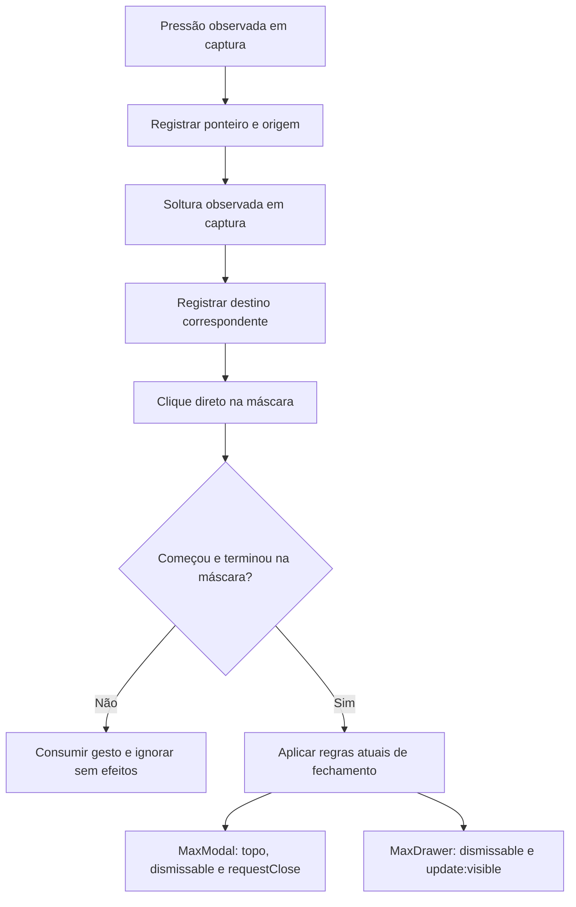

# Especificação técnica — proteção de arraste no MaxModal e MaxDrawer

## 1. Contexto & Objetivo

- Data: 15/10/2026.
- Projeto: `@maxvue/max-components-ui` 1.1.7.
- Worktree e branch: `wt-4edd89d1`.
- Raiz confirmada por `pwd` e `git rev-parse --show-toplevel`: `/home/johnattas/GitHub/MaxComponentsUi/.max-code-worktrees/wt-4edd89d1`.
- Situação: ao iniciar uma seleção dentro de um modal/drawer e soltar sobre a máscara externa, o componente pode interpretar a interação como pedido de fechamento.
- Objetivo: não fechar nem iniciar confirmação de fechamento por um arraste que começou dentro do painel. Continuar fechando por um clique direto legítimo na máscara, conforme a configuração existente.

### Evidências e limites

| Evidência inspecionada | Constatação |
| --- | --- |
| `src/components/MaxModal.vue:8–30,331–338` | Máscara recebe `@click.stop`; o painel impede propagação de cliques internos. `onBackdropClick` só verifica topo e `dismissable`, e então chama `requestClose('backdrop')`. Não há memória da origem do gesto. |
| `src/components/MaxDrawer.vue:2–22,189–205` | Máscara recebe `@click.self`; `onMaskClick` verifica apenas `dismissable`. O componente emite intenção de fechamento, sem modificar a prop. |
| `tests/components/MaxModal.test.ts` e `MaxDrawer.test.ts` | Cobrem clique isolado na máscara, Escape, APIs, visibilidade e acessibilidade; não reproduzem pressão interna seguida de soltura externa. |
| `src/stores/useModal.Store.ts` | Pilha existente do MaxModal utiliza Pinia; não precisa de alteração para um gesto transitório. |
| `vitest.config.ts`, `vitest.browser.config.ts`, `tests/setup.ts`, `tests/browser.setup.ts` | Há testes Happy DOM e Chromium real. O runner de navegador usa iframe; o adaptador de Axios e requisições de ícones são tratados no setup. |
| `tests/browser/MaxFocusStack.browser.ts` | Referência existente de montagem com `createApp`, Pinia e limpeza de overlays/foco; os cenários não usam os dois componentes reais deste pedido. |
| MaxUse instalado, `dist/Helpers/VueUse/index.d.ts:93–94,272–273` | Exporta `onClickOutside` e `useEventListener`. Não é necessário criar helper genérico nem atualizar dependências. |

A MDN descreve que uma pressão e uma soltura em elementos diferentes podem gerar `click` no ancestral comum. Portanto, `.self` sozinho não resolve: a própria máscara pode ser esse ancestral. A causa é compatível com o código e o relato, mas não foi reproduzida em execução nesta sessão de planejamento.

Versões observadas em disco: Vue `3.6.0-rc.10`, Vitest e provider Playwright `4.1.11`, MaxUse `1.1.47`, VueUse `14.4.0`. `node_modules` resolve para o diretório compartilhado da árvore principal; não instalar nem modificar esse destino. MaxPinia é peer opcional no manifesto e não está disponível em `node_modules/@maxvue/max-pinia/package.json`; isso não comprova defeito e não exige migração de store neste escopo.

## 2. Escopo

### Incluído

1. Proteção equivalente nos componentes reais MaxModal e MaxDrawer.
2. Diferenciação entre clique direto na máscara e clique derivado de arraste envolvendo o conteúdo.
3. Testes de sequências de eventos, contratos de fechamento e ciclo de vida.
4. Regressão no Chromium com pressão, movimento e soltura reais, inclusive seleção em input.
5. Registro do defeito da biblioteca em `docs/notifications/wt-4edd89d1/notifications/max-components-ui-fechamento-por-arraste.md`.

### Fora de escopo

- Desativar globalmente `dismissable`, criar props, alterar defaults, eventos públicos, slots ou métodos expostos.
- Modificar `beforeClose`, pilha de modais, regras de Escape, foco, scroll, z-index, transições ou aparência.
- Migrar stores para MaxPinia, introduzir cache/salvamento, criar acessos HTTP ou alterar dados persistentes.
- Corrigir outros overlays ou refatorar helpers existentes.
- Adicionar PrimeVue, dependências locais ou novas bibliotecas.
- Instalação, publicação, release, commit, merge, push, troca de branch ou criação/remoção de worktree.

## 3. Arquitetura & Mudanças Técnicas

### Arquivos de implementação previstos

| Arquivo | Situação | Alteração futura |
| --- | --- | --- |
| `src/components/MaxModal.vue` | Existente | Guardar a origem e o término do gesto na máscara antes de chamar o fechamento atual. |
| `src/components/MaxDrawer.vue` | Existente | Aplicar a mesma regra sem depender de `panel_el`, que pode não existir com slot `container`. |
| `tests/components/MaxModal.test.ts` | Existente | Sequências de arraste, efeitos ausentes, fechamento legítimo e preservação dos contratos. |
| `tests/components/MaxDrawer.test.ts` | Existente | Sequências equivalentes, componente controlado e slot `container`. |
| `tests/browser/MaxOverlayBackdropGesture.browser.ts` | Novo proposto | Montar componentes reais e validar seleção/arraste e clique direto. Incluir a declaração de tipos do novo comando no próprio arquivo, se necessário. |
| `vitest.browser.config.ts` | Existente | Acrescentar um comando tipado de gesto real usando o provider já presente; preservar `setPageScaleFactor` e configuração atual. |

Não criar composable público. Usar pequenas funções privadas tipadas nos dois componentes. O estado do gesto é local por instância, não pertence a uma store. Preservar `useModalStore` e integrações atuais; a obrigação de usar MaxPinia para novas camadas de dados não demanda criar uma camada de dados para eventos DOM. Reutilizar helpers do MaxUse para listeners adicionais, sem import direto de VueUse novo.

### Regra proposta do gesto

1. Observar `pointerdown` e `pointerup` na máscara em **captura**. A captura deve observar também eventos de descendentes que interrompam a propagação. Não usar `.self` para registrar esses dois eventos.
2. Registrar por instância a identidade do ponteiro, se é interação primária e se começou diretamente na máscara (`target === currentTarget`).
3. Na soltura correspondente, registrar se terminou diretamente na mesma máscara. Um início ou término no painel/descendente torna o gesto inelegível para fechamento.
4. No `click` da máscara, verificar alvo direto e elegibilidade do gesto antes de qualquer efeito. Só então executar o handler atual. Consumir o registro para não reaproveitá-lo.
5. Preservar cliques isolados sem sequência de ponteiro e com `detail === 0` em estado neutro, utilizados por `.click()` e pelos testes atuais. Isso não pode sobrepor um gesto observado como interno ou cancelado. Não usar `isTrusted` para fazer testes sintéticos passarem por outro caminho.
6. Não fechar em `pointerdown` ou `pointerup`. Não limpar o registro em `pointerup` antes do `click`, não usar temporizador, debounce ou limite arbitrário de deslocamento.
7. Invalidar interação cancelada (`pointercancel`) ou interrompida por perda de foco da janela. Um novo `pointerdown` inicia um registro novo; fechar/reabrir limpa o ciclo anterior; desmontagem remove listeners. Evitar estado compartilhado entre instâncias.
8. Usar `useEventListener` exportado pelo MaxUse para listener adicional de janela, com proteção de SSR e descarte pelo ciclo de vida. Listeners das máscaras podem permanecer declarativos no template. Não alterar o helper canônico existente de Escape.
9. Aplicar antes da verificação de `dismissable` do MaxModal: arraste ignorado não deve provocar nem `before-close` nem `is-shaking`. Clique direto com `dismissable=false` continua provocando o feedback atual no modal; no drawer continua sem fechar.
10. Preservar a guarda `isTopModal` do modal. Não adicionar nova política de pilha ao drawer.

Os nomes e a representação privada podem ser ajustados pelo executor, mas a máquina deve distinguir ausência de gesto, gesto elegível e gesto inválido/cancelado; não tratar ausência de origem como autorização de clique físico. Gestos secundários ou de ponteiros incompatíveis não podem autorizar fechamento.

### Fluxo

### Contratos preservados

- MaxModal continua utilizando `requestClose('backdrop')`, com a mesma razão, veto/espera de `beforeClose`, eventos e gerenciamento da pilha.
- MaxDrawer continua controlado: um fechamento válido emite `update:visible=false`; `hide` depende da atualização posterior da prop pelo consumidor.
- Botão, Escape e métodos expostos não passam a depender de estado de ponteiro.
- Slots, classes existentes e anatomia DOM não recebem wrappers novos. Tags de abertura alteradas devem ficar em uma linha, conforme `AGENTS.md`.
- Não impedir comportamento nativo de seleção, foco ou rolagem: sem `preventDefault`, captura forçada de ponteiro ou alteração de `user-select` para contornar o defeito.

### Decisões e alternativas

- Proposta adotada: guarda local da sequência, mantendo a decisão final em `click`. Resolve também arraste inverso, no qual o ancestral comum pode ser a máscara.
- Apenas `.self`: descartado porque o ancestral comum já pode ser a própria máscara.
- Fechar no início do clique: descartado por alterar a interação existente e arrastes que terminam dentro.
- `dismissable=false` para todos: descartado por remover funcionalidade legítima.
- Trocar por `onClickOutside`: o helper existe no MaxUse, mas seu uso como substituição global ampliaria a área de fechamento e requereria tratar painel ausente no slot `container`. O código instalado também ajusta a guarda para `detail===0`. Não adotá-lo automaticamente para esta correção pontual.
- Novo helper/pacote ou migração de store: desnecessários; não há lacuna de helper MaxUse demonstrada.

## 4. Plano de Execução Faseado

1. **Preflight somente por leitura:** conferir plano, trabalho existente, branch/worktree, scripts/prehooks, resolução efetiva das libs e isolamento do harness antes de alterações dependentes.
2. **Lote funcional completo:** implementar as duas guardas, testes unitários, comando tipado e regressão de navegador, sem validações entre microedições.
3. **Revisão de risco do lote:** comparar regras dos dois componentes e verificar captura, cancelamento, slot `container`, SSR e ausência de efeitos no arraste.
4. **Validação agrupada:** executar gates de integridade aplicáveis, testes completos, tipos, lint, build e navegador; corrigir problemas em lote e reexecutar somente checks invalidados.
5. **Aceite e handoff:** revisar diff, registrar resultados reais e pendências manuais. Não integrar nem publicar.

O detalhamento operacional, a matriz de aceite e o registro de execução estão em `plan.md` nesta mesma pasta. Nesta sessão Plan, somente documentos foram autorizados: nenhuma dessas fases foi executada.

## 5. Critérios de Aceite & Validação

1. Pressionar em input/texto do MaxModal ou MaxDrawer, arrastar até a máscara e soltar mantém o painel aberto e a seleção utilizável.
2. Esse arraste não emite intenção de fechamento, não chama `beforeClose`, não altera a pilha e não causa tremor.
3. Pressionar e soltar diretamente na máscara fecha uma vez quando permitido, incluindo o primeiro clique direto depois de um arraste ignorado.
4. Pressionar na máscara e soltar em conteúdo não fecha, ainda que um clique seja direcionado ao ancestral máscara.
5. Configurações de `dismissable`, `closeOnEscape`, `beforeClose`, visibilidade e topo da pilha continuam com seus efeitos atuais.
6. Slot `container` do drawer, stop de eventos em inputs, cancelamento, reabertura e múltiplas instâncias não deixam estado residual.
7. Regressão física passa no Chromium com os dois componentes reais. Eventos despachados manualmente não substituem o aceite de seleção real.
8. Tipos, lint, build e testes aplicáveis aprovados na revisão final, sem warnings novos ou bypass de gates.

Comandos existentes para execução futura: `npm run check:lockfile`, `npm run test`, `npm run type-check`, `npm run type-check:test`, `npm run lint`, `npm run build` e `npm run test:browser`. O plano discrimina ordem e deduplicação de tipos/build. `npm run verify` é gate de pré-release; release não faz parte deste pedido.

Validações manuais futuras: seleção longa em input, textarea e texto comum; soltura externa pelos lados disponíveis; clique direto subsequente; toque simples fora e rolagem interna; verificação em Firefox/Safari quando disponíveis. Ausência de ambiente necessário deve ser registrada como `manualPending`, nunca como aprovação.

### Referências consultadas

- Vue 3, captura e modificadores: https://vuejs.org/guide/essentials/event-handling — documentação oficial consultada via Context7.
- Semântica de `click`: https://developer.mozilla.org/en-US/docs/Web/API/Element/click_event.
- Comandos de navegador Vitest: https://github.com/vitest-dev/vitest/blob/v4.1.6/docs/api/browser/commands.md — versão 4.1.6 disponível no Context7; instalada 4.1.11. Reconfirmar tipagem efetiva antes de implementar o comando.
- Consulta e leitura não equivalem a teste de runtime. Não foram executados testes, scripts do projeto, instalações ou chamadas a serviços de aplicação.
